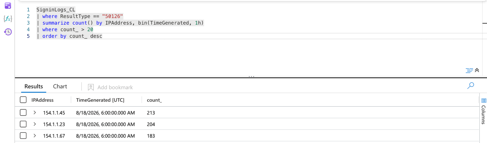

# SOC Investigation — CEO Account Takeover (Microsoft Sentinel)

**From a SOC perspective:** I simulated a password spray followed by a suspicious 3 AM sign-in to a CEO account, ingested the logs into Microsoft Sentinel, and wrote a KQL query that surfaced 600 failed sign-ins (error 50126) coming from three rotating attacker IPs.

## Scenario

A company's CEO account shows a successful sign-in at 3 AM from Lagos, Nigeria, a location the CEO has never signed in from. The SOC's job is to work out whether this is a real compromise and how the attacker got in.

Simulated timeline:

| When | Activity |
|---|---|
| Night 1 | ~300 failed sign-ins across 40 accounts from 3 rotating IPs |
| Night 2 | Another ~300 failed sign-ins, same pattern |
| Day 0, 3 AM | Successful sign-in to `ceo@company.com` from `154.1.1.23` (Office 365) |

All data is synthetic. No real users or tenants are involved. The `154.1.1.x` addresses are stand-ins for attacker infrastructure.

## Lab architecture

```
 ┌───────────────────────────┐      HTTPS POST        ┌──────────────────────────────┐
 │  Python scripts (local)   │  (HTTP Data Collector  │  Azure Log Analytics         │
 │                           │        API)            │  workspace                   │
 │  generate_password_spray  │ ─────────────────────▶ │  table: SigninLogs_CL        │
 │  test_log (CEO sign-in)   │                        └──────────────┬───────────────┘
 └───────────────────────────┘                                       │
                                                                     ▼
                                                     ┌──────────────────────────────┐
                                                     │  Microsoft Sentinel          │
                                                     │  KQL hunting in Logs         │
                                                     └──────────────────────────────┘
```

## Tools

| Tool | Role |
|---|---|
| Microsoft Sentinel | SIEM used for hunting |
| Azure Log Analytics | Stores the simulated logs (`SigninLogs_CL` custom table) |
| KQL | Query language for detection |
| Python + `requests` | Generates synthetic sign-in logs and sends them to the workspace |

## Main steps

1. **Created the workspace** — set up a Log Analytics workspace (`law-soc-investigation`) and enabled Microsoft Sentinel on it.
2. **Simulated the attack** — `generate_password_spray.py` sent two nights of failed sign-ins (ResultType `50126`, "invalid username or password") spread across 40 accounts from 3 IPs.
3. **Simulated the takeover** — `test_log.py` sent one successful CEO sign-in from Lagos.
4. **Hunted with KQL** — grouped failed sign-ins by source IP and time window to find sources that fail far more often than a normal user would.

## Results

The detection query counts failed sign-ins per source IP per hour and keeps only sources above 20 failures:

```kql
SigninLogs_CL
| where ResultType == "50126"
| summarize count() by IPAddress, bin(TimeGenerated, 1h)
| where count_ > 20
| order by count_ desc
```

| Source IP | Failed sign-ins |
|---|---|
| 154.1.1.45 | 213 |
| 154.1.1.23 | 204 |
| 154.1.1.67 | 183 |
| **Total** | **600** |



**Why this is a password spray, not a normal lockout:** a real user who forgets their password fails a handful of times on one account. Here, three IPs together produced 600 failures spread across 40 different accounts, which matches the spray pattern of trying a few common passwords against many accounts to stay under per-account lockout thresholds. `154.1.1.23`, one of the spraying IPs, is also the source of the CEO's successful sign-in.

## MITRE ATT&CK mapping

| Technique | ID | Evidence in this lab |
|---|---|---|
| Brute Force: Password Spraying | T1110.003 | 600 failed sign-ins (50126) across 40 accounts from 3 IPs |
| Valid Accounts: Cloud Accounts | T1078.004 | Successful CEO sign-in from a spraying IP |

## Response recommendations

If this were a real incident:

- Reset the CEO's password and revoke all active sessions and refresh tokens.
- Block the three source IPs and review any other successful sign-ins from them.
- Enforce MFA for all accounts, starting with executives.
- Turn the hunting query into a scheduled analytics rule so future sprays raise an alert automatically.

## Lessons learned and next improvements

- **Ingestion time vs event time.** All 600 failures landed in a single one-hour bin even though the script spread them across two nights. The HTTP Data Collector API stamps `TimeGenerated` with the ingestion time unless the `time-generated-field` header is set, so the simulated timestamps were not used. Next step: send that header so the timeline in Sentinel matches the scenario.
- **Correlate failures with the success.** Next step: join the spraying IPs to successful sign-ins (`ResultType == "0"`) to flag the CEO login automatically instead of by eye.
- **Detect by spread, not just volume.** Next step: add `dcount(UserPrincipalName)` to the query, since many accounts per IP is a stronger spray signal than raw failure count.

## Running the scripts

Credentials are read from environment variables, never stored in the code:

```powershell
$env:LA_WORKSPACE_ID="<workspace id>"
$env:LA_PRIMARY_KEY="<primary key>"
pip install requests
python generate_password_spray.py
python test_log.py
```

On macOS or Linux use `export LA_WORKSPACE_ID=...` instead.

| File | Purpose |
|---|---|
| `generate_password_spray.py` | Sends two nights of failed sign-ins |
| `test_log.py` | Sends the successful CEO sign-in |
| `common.py` | Shared helper that signs and posts logs to the workspace |
